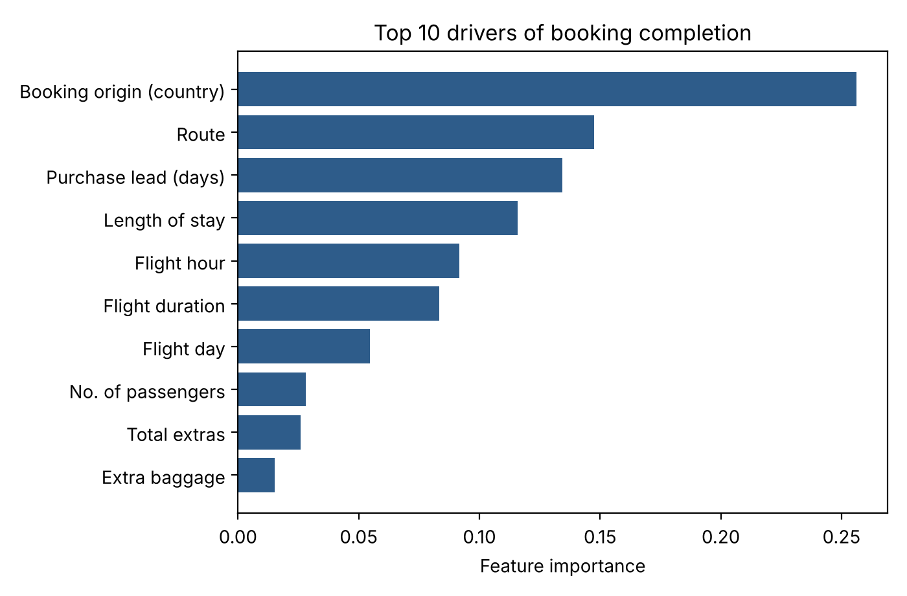

# ✈️ British Airways – Lounge Demand Modelling & Booking Prediction

**Forage job simulation · British Airways Data Science · Nov 2026**
[View credential](https://www.theforage.com/completion-certificates/tMjbs76F526fF5v3G/NjynCWzGSaWXQCxSX_tMjbs76F526fF5v3G_6aeda13e3a37e82da041028f_1794419878281_completion_certificate.pdf)

**Tools:** Excel (Pivot Tables, Calculated Fields) · Python (Pandas, scikit-learn, Matplotlib) · PowerPoint

---

## Task 1 – Lounge eligibility at Heathrow Terminal 3

**Business question:** How many passengers on a future flight schedule will be eligible for each lounge tier (Concorde Room, First Lounge, Club Lounge)?

**What I did**
1. Explored a **10,000-flight summer schedule** (region, haul, aircraft, seats, eligible passengers per tier).
2. Added a `TOTAL_SEATS` column and built a pivot table by **arrival region × haul**.
3. Calculated eligibility % per tier = eligible passengers ÷ total seats (Excel calculated fields).
4. Built a **reusable lookup table** + written justification so BA can apply it to any future schedule.

**Result – lounge eligibility lookup table**

| Group | Example destinations | Tier 1 | Tier 2 | Tier 3 |
|---|---|---|---|---|
| Europe – Short-haul | Frankfurt, Munich, Vienna, Madrid | 0.34% | 4.40% | 16.85% |
| North America – Long-haul | Chicago, Los Angeles, New York, Dallas | 0.20% | 2.76% | 10.55% |
| Asia – Long-haul | Tokyo (Haneda) | 0.19% | 2.70% | 10.35% |
| Middle East – Long-haul | Dubai | 0.21% | 2.69% | 10.29% |
| **All flights** | | **0.27%** | **3.53%** | **13.52%** |

**Insight:** European short-haul flights have the highest share of lounge-eligible passengers (frequent business travellers), while long-haul regions behave very similarly – so region + haul is a simple, scalable way to forecast lounge demand.

📄 [Lookup table & justification (Excel)](task1_lounge_eligibility/Lounge_Eligibility_Lookup_Rehan.xlsx)

---

## Task 2 – Predicting customer booking behaviour

**Business question:** Which customers are likely to complete a booking, and what drives that decision?

**What I did**
1. Explored **50,000 booking enquiries** (only 15% end in a booking – an imbalanced target).
2. Feature engineering: mapped flight day to numbers, added `is_weekend` and `total_extras`, frequency-encoded route and booking country, one-hot encoded sales channel and trip type.
3. Trained a **Random Forest** classifier (balanced class weights).
4. Evaluated with **5-fold stratified cross-validation**.

**Results**

| Metric | Score |
|---|---|
| Accuracy | 0.76 |
| ROC-AUC | 0.78 |
| Recall (bookers found) | 0.60 |
| Precision | 0.34 |

**Insights**
- **Booking origin (customer's country)** is the strongest driver (26% importance), followed by **route**, **purchase lead time**, **length of stay** and **flight hour**.
- Add-ons (baggage, seat, meals), sales channel and trip type have little influence.
- The model finds 6 in 10 real bookers – useful for targeting offers by country, route and timing. Next step: more customer data and other models to improve precision.

📓 [Notebook](task2_booking_prediction/booking_prediction_model.ipynb) · 🐍 [Python script](task2_booking_prediction/booking_prediction_model.py) · 📊 [Summary slide (PDF)](task2_booking_prediction/results_summary_slide.pdf)

---

### Notes
- The raw datasets are provided by Forage for simulation use only and are **not included** here. To run the notebook, download `customer_booking.csv` from the simulation and place it next to the notebook.
- This is a Forage virtual job simulation, not employment with British Airways.

👤 **Rehan Deshmukh** · [LinkedIn](https://www.linkedin.com/in/rehan-akhtar-deshmukh-25bb93269/) · [GitHub profile](https://github.com/rehan-deshmukh1110)
